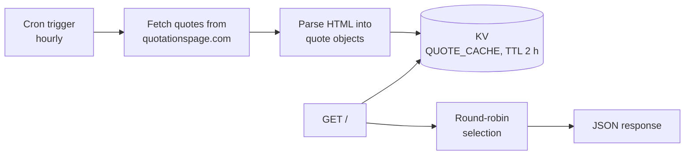

# quote

A tiny [Cloudflare Worker](https://developers.cloudflare.com/workers/) that serves a rotating stream of famous quotes as JSON.

Every hour a scheduled cron job fetches random quotes from [The Quotations Page](https://www.quotationspage.com), parses them into structured JSON, and stores them in a KV namespace. Each HTTP request then returns the next quote in a round-robin fashion — no external API keys, no heavyweight dependencies, just one JS file.

## How it works



- The cron trigger (`0 * * * *`, configurable in `wrangler.jsonc`) refreshes the cache every hour.
- Cached entries expire after 2 hours, so a failed fetch never serves stale data forever.
- Quotes are served round-robin using a counter persisted alongside the quotes in KV. If the per-key write rate limit is hit, the counter simply keeps its previous value.
- If the cache is empty (e.g. right after deployment, before the first cron run), the worker returns an empty JSON array.

### Response format

Each request returns a single quote:

```json
{
  "text": "The only true wisdom is in knowing you know nothing.",
  "author": "Socrates",
  "source": null,
  "years": "(470 BC - 399 BC)"
}
```

| Field    | Description                                             |
| -------- | ------------------------------------------------------- |
| `text`   | The quote itself, HTML-stripped and entity-decoded      |
| `author` | Author name (lifespan dates removed), or `"Unknown"`    |
| `source` | Work the quote comes from, when stated in italics, or `null` |
| `years`  | Author lifespan, e.g. `"(1859 - 1930)"`, or `null`      |

## Endpoints

| Route               | Description                                                        |
| ------------------- | ------------------------------------------------------------------ |
| `GET /`             | Return the next quote in the round-robin rotation                  |
| `GET /__cron/refresh` | Manually trigger a cache refresh (handy right after deploying)   |

## Getting started

> [!NOTE]
> You need a [Cloudflare account](https://dash.cloudflare.com/sign-up) and [Node.js](https://nodejs.org) with npm.

Clone the repository and install dependencies:

```sh
npm install
```

Run the worker locally (a local KV simulation is used automatically):

```sh
npm run dev
```

### Setup

The `QUOTE_CACHE` KV binding in `wrangler.jsonc` intentionally has **no namespace `id`** — Wrangler's [automatic provisioning](https://developers.cloudflare.com/workers/wrangler/configuration/#automatic-provisioning) creates a matching namespace on first deploy, so no IDs live in this repository.

Log in to your Cloudflare account:

```sh
npx wrangler login
```

### Deploy

```sh
npm run deploy
```

> [!WARNING]
> Wrangler may **write the provisioned KV namespace id back into `wrangler.jsonc`** on a local deploy. If that happens, restore the file before committing: `git checkout -- wrangler.jsonc`.

After deploying, optionally warm the cache right away:

```sh
curl https://quote.<your-subdomain>.workers.dev/__cron/refresh
```

## Continuous deployment

Every push to `main` deploys to Cloudflare via GitHub Actions (`.github/workflows/deploy.yml`): parser test → `wrangler deploy` → one `GET /__cron/refresh` to warm the cache.

Set these repository secrets (Settings → Secrets and variables → Actions):

| Secret                   | How to get it                                                                                                   |
| ------------------------ | --------------------------------------------------------------------------------------------------------------- |
| `CLOUDFLARE_API_TOKEN`   | Create an API token with the *Edit Cloudflare Workers* template in the [Cloudflare dashboard](https://dash.cloudflare.com/profile/api-tokens) |
| `CLOUDFLARE_ACCOUNT_ID`  | Account ID (right side of the Cloudflare dashboard overview page)                                                |

## Testing the parser

A small script extracts the parsing logic so it can be checked against a saved HTML page:

```sh
# run against a saved HTML page (defaults to quotes.html)
node test/parser-test.js quotes.html
```

## Project structure

```
quote/
├── src/
│   └── worker.js      # Worker entry point: fetch handler, cron handler, HTML parser
├── test/
│   └── parser-test.js # Standalone script for testing the quote parser
├── wrangler.jsonc     # Worker config: KV binding, cron trigger
└── package.json
```

## Configuration

All configuration lives in [`wrangler.jsonc`](wrangler.jsonc):

| Setting                        | Default       | Purpose                                   |
| ------------------------------ | ------------- | ----------------------------------------- |
| `triggers.crons`               | `0 * * * *`   | Hourly cache refresh schedule             |
| `kv_namespaces[].binding`      | `QUOTE_CACHE` | KV namespace used for the quote cache     |
| Cache TTL (in `worker.js`)     | `7200` s      | How long cached quotes stay valid (2 h)   |
